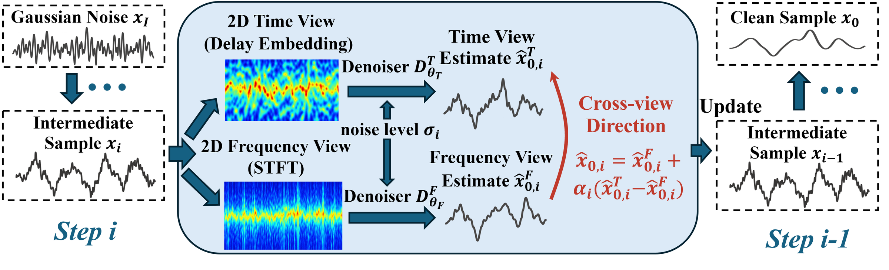
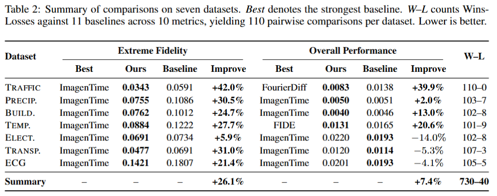

<h1 align="center">Cross-View Time-Frequency Diffusion for Extreme-Aware Time-Series Generation</h1>

<p align="center">
  Anonymous authors &nbsp;·&nbsp; Paper under double-blind review
</p>

<p align="center">
  
</p>

**CrossTF** trains a **time-view** and a **frequency-view** diffusion denoiser separately and
**fuses them step by step** at the end of sampling, with per-step coefficients solved for
**extreme-value fidelity**.

## Main results

<p align="center">
  
</p>

## Reproduce the tables

**All generated samples behind the paper are released in `results/`.** After [setup](#setup),
one command rebuilds the per-dataset tables for every method, **on CPU**:

```bash
python evaluation/make_table.py --out tables/
```

The three learned metrics (discriminative, predictive, Context-FID) need a GPU:

```bash
python evaluation/evaluate.py --dataset precipitation --all
```

## Setup

```bash
conda create -n crosstf python=3.10 -y && conda activate crosstf
pip install torch==2.13.0 torchaudio==2.11.0 --index-url https://download.pytorch.org/whl/cu130   # match your CUDA
pip install -r requirements.txt
```

**Keep the torchaudio version**: the frequency view depends on it. Each baseline has its own
environment; see [`baselines/README.md`](baselines/README.md).

## Run CrossTF

**From the released checkpoints** (Precipitation, no training):

```bash
python main.py --config_file configs/precipitation.yaml --train  --crosstf --log_dir pretrained            # solve the fusion coefficients
python main.py --config_file configs/precipitation.yaml --sample --crosstf --log_dir pretrained --seed 4   # sample -> outputs/
```

**From scratch** (Precipitation, one seed):

```bash
python main.py --config_file configs/precipitation.yaml --train  --time      --seed 1   # train the time branch
python main.py --config_file configs/precipitation.yaml --train  --frequency --seed 1   # train the frequency branch
python main.py --config_file configs/precipitation.yaml --train  --crosstf   --solve_seeds 1
python main.py --config_file configs/precipitation.yaml --sample --crosstf   --seed 1   # sample -> outputs/
```

**All datasets, as in the paper:** `bash run_crosstf.sh`

`pretrained/` holds the six Precipitation branches as a sample; due to space limits,
**all checkpoints will be released upon acceptance.**

## Repository

```
main.py, run_crosstf.sh   entry point and full pipeline
configs/                  one config per dataset
models/, crosstf/         branch diffusion models; cross-view fusion and coefficient solver
evaluation/               metrics and make_table.py
data/                     the seven datasets
results/                  generated samples behind the paper (CrossTF and baselines)
pretrained/               sample checkpoints (Precipitation)
baselines/                the eleven baselines
```

## Acknowledgements

`models/networks.py` builds on [EDM](https://github.com/NVlabs/edm) (CC BY-NC-SA 4.0); the
image transforms and training scaffolding are adapted from
[ImagenTime](https://github.com/azencot-group/ImagenTime); `evaluation/ts2vec/` is
[TS2Vec](https://github.com/zhihanyue/ts2vec) (MIT). Baseline sources and licenses are listed in
[`baselines/README.md`](baselines/README.md).
